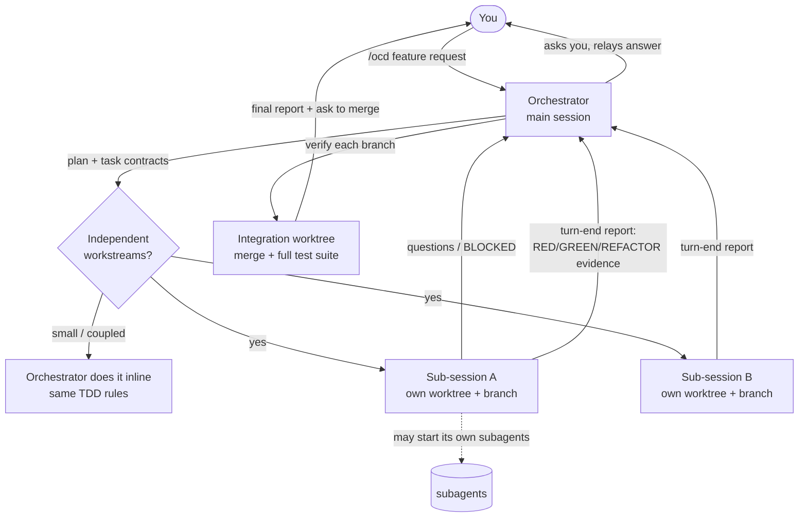

# orchestrated-tdd

A Claude Code skill that turns your main conversation into a development **orchestrator**. You describe a feature once. The orchestrator plans it, starts a **sub-session** for each independent workstream, and makes every sub-session build test-first with regression guards. It relays their questions to you, then merges and verifies the combined result itself.

You talk only to the orchestrator. Every sub-session is a real Claude Code session started *under* the orchestrator in its own git worktree, and you can open it in the Desktop app whenever you want.

## How it works



1. **Ground.** The orchestrator reads project instructions and code, detects the real test, lint, typecheck, and build commands, and records git state and its own reply address.
2. **Plan.** It sets acceptance criteria and splits the work into tasks with file ownership and a dependency order. It decides what to delegate and what to do inline, and may give several tasks to one sub-session. It shows you the plan with any questions batched together.
3. **Dispatch.** It starts one sub-session per workstream with `start_session` (`use_worktree: true`, fresh context). Each prompt is a filled task contract followed by the TDD cycle.
4. **Track and route.** It keeps a ledger with this lifecycle: `PLANNED → RUNNING → BLOCKED | COMPLETED | FAILED → VERIFIED → INTEGRATED`. Turn-end reports arrive automatically. Questions come to you in plain language with options and a recommendation, and your answer goes back to the right sub-session.
5. **Verify each task.** The orchestrator reads each branch diff, checks that the RED evidence failed for the right reason, re-runs the tests, and spot-checks a regression guard. A task COMPLETED is not yet VERIFIED.
6. **Integrate.** It merges every branch into a separate integration worktree and runs the **full** suite, lint, typecheck, and build there. It resolves conflicts openly.
7. **Report.** It tells you what was implemented, how each task went, the tests and regression guards, the exact verification commands and results, the integration, outstanding issues, and the approval decisions. Then it asks before landing anything on your branch.

## Token savings with a knowledge graph

If the repo has a code knowledge graph, the skill uses it to cut what each sub-session spends on exploration. It recognizes graphify (`graphify-out/graph.json`), codebase-memory-mcp, and any graph tool your project instructions name.

- The orchestrator queries the graph once. It maps the structure, finds the affected symbols, and traces their inbound callers, which also tells it how to divide file ownership.
- It gives each sub-session a small **context slice**: the symbols to change with `file:line`, the callers that must keep working, and the covering tests, plus the exact graph commands.
- The sub-session starts from that slice, queries the graph, and reads snippets instead of whole files.
- Sub-sessions never reindex or commit graph files, because parallel branches would conflict on them. The orchestrator refreshes the graph once, after integration, and runs a ripple check on the changed public symbols.

No graph yet? During Ground the orchestrator asks whether to build one. It offers only tools you have installed, with their cost: a codebase-memory-mcp index (local, no API calls), or a graphify graph (the first build may call an LLM API, and it writes `graphify-out/` into the repo). It notes that the savings grow with long runs, many sub-sessions, and later `/ocd-fix` iterations. If you say no, it uses normal search and doesn't ask again in that chat.

## Guarantees the skill enforces

- **Single gateway.** Sub-sessions never ask you anything directly. Every question and approval passes through the orchestrator.
- **Your branch is untouched** until the integrated result passes and you approve the merge.
- **Evidence or it didn't happen.** RED, GREEN, REFACTOR, and verification count only with commands that were actually run and output that was actually observed.
- **Regression guards are mandatory.** Every new behavior gets tests that fail if it breaks, and at least one guard is proven by breaking the code on purpose.
- **Explicit approval** before destructive actions, production or live systems, migrations, new dependencies or costs, security-weakening changes, scope changes, merging, and cleanup. A recommendation never counts as approval, and a blocked action is never handed to another session to do.

## Install

```bash
git clone https://github.com/Danamiq/orchestrated-tdd ~/.claude/skills/orchestrated-tdd
mkdir -p ~/.claude/commands
cp ~/.claude/skills/orchestrated-tdd/commands/ocd.md ~/.claude/commands/ocd.md           # /ocd
cp ~/.claude/skills/orchestrated-tdd/commands/ocd-fix.md ~/.claude/commands/ocd-fix.md   # /ocd-fix
```

Start a new Claude Code session to load it.

## Use

From a Claude Code session in the **Claude Desktop app**:

```
/ocd add CSV export to GET /reports/:id/export and a `reports export <id> --format csv` CLI command
```

`/orchestrated-tdd ...` works too, and Claude may pick the skill on its own for multi-file features you ask to have built test-first.

### Iterating on a feature: `/ocd-fix`

```
/ocd-fix the CSV export puts dates as epoch millis, should be ISO 8601; the CLI also ignores --format json
```

A fix is another iteration on a feature that `/ocd` already built. Run it **in the same chat that ran `/ocd`**; that orchestrator is the parent of the sub-sessions. In any other chat, `/ocd-fix` stops and points you back to the original one. The orchestrator **doesn't create new child sessions** for a fix. Instead:

- It finds the sub-sessions that built the affected code, using its ledger, `list_sessions`, or git branch ownership.
- It sends each owner a short fix contract with `SendMessage`. The owner keeps its context, worktree, and TDD history.
- The owner first updates its branch to the current integrated code. Then it writes a failing test that reproduces the problem, fixes it, and keeps that test as a regression guard.
- The orchestrator re-integrates in a fresh integration worktree, runs the full suite, and asks before landing.

If an owner is archived or unreachable, the orchestrator asks you before doing anything else. You can let it fix the problem inline on that branch, or approve a new sub-session.

## Requirements

- **Claude Desktop (Code).** Sub-sessions use the Desktop session tools: `mcp__ccd_session__start_session`, `mcp__ccd_session_mgmt__get_session`, `list_events`, and `archive_session`, plus `SendMessage`.
- **Terminal CLI.** These tools don't exist there. The skill tells you so and offers a fallback you must approve: separate `claude --bg` sessions in worktrees. Those are detached sessions, not children of the orchestrator. They need a trusted workspace and should run in `auto` or `acceptEdits` mode.
- **A git repository.** Only committed work reaches worktrees. If the tasks depend on uncommitted changes, the orchestrator asks you how to proceed.

## Limitations

- Messages between sessions arrive at the receiver's next tool round or turn; there are no live interrupts.
- A tool-permission prompt inside a sub-session can't be relayed. The orchestrator tells you which sub-session to open and answer.
- Worktrees isolate edits, not semantics, which is why integration verification is mandatory.
- Each sub-session is a full session, so parallel work multiplies token use, disk, and dependency installs. The default cap is 3 running at once.

## Verification status

| What | How it was checked |
|---|---|
| Skill structure and frontmatter | `quick_validate.py` from Anthropic's skill-creator: `Skill is valid!` |
| `start_session` parameters, turn-end notes, `SendMessage` to `local_…` ids, `get_session` / `list_events` / `archive_session` | Real Claude Desktop sessions in which a parent ran five worktree sub-sessions in parallel |
| CLI fallback (`claude --bg -w`, cross-session messages both ways, waking idle sessions, nested subagents, contract text passed intact, `stop`/`rm` by id) | Live probe on Claude Code 2.1.311 |
| End-to-end `/ocd` or `/ocd-fix` run on a real feature | **Not yet run.** `evals/` holds four test prompts; they need a target repo. |

## Layout

| Path | Purpose |
|---|---|
| `SKILL.md` | Orchestrator workflow, invariants, approval boundaries, final report format |
| `references/orchestration.md` | Sub-session tools, dispatch, messaging and turn-end reports, status, permission prompts, worktree base, stacked tasks, retries, conflicts, integration, fix iterations, user access, cleanup, CLI fallback |
| `references/knowledge-graph.md` | Detecting graphify / codebase-memory-mcp, context slices, sub-session graph rules, post-integration refresh |
| `references/task-contract.md` | Prompt template each sub-session receives, plus the fix-contract template for `/ocd-fix` |
| `references/tdd-cycle.md` | TDD phases A–F, regression-guard checklist, stack detection; appended to every sub-session prompt |
| `commands/ocd.md` | `/ocd` slash command: new feature |
| `commands/ocd-fix.md` | `/ocd-fix` slash command: fix iteration that reuses existing sub-sessions |
| `evals/` | Test cases in the `claude plugin eval` layout |
| `CHANGELOG.md` | Design history |

## License

MIT
